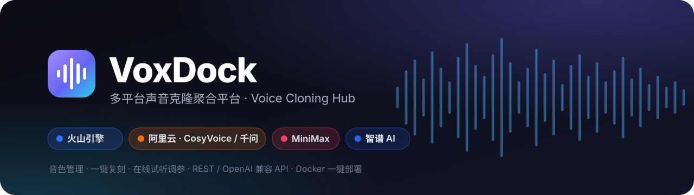
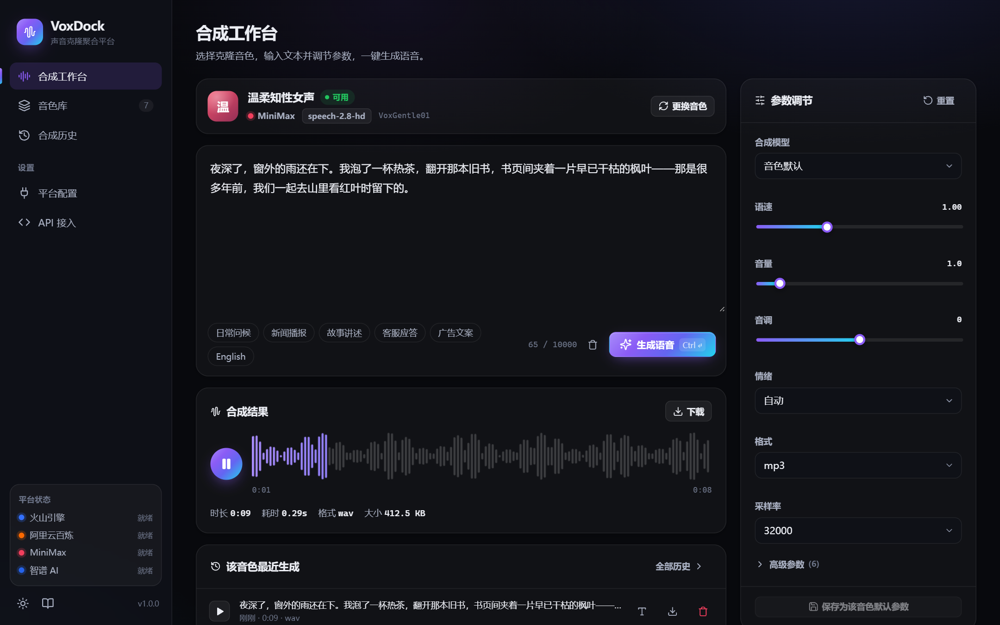
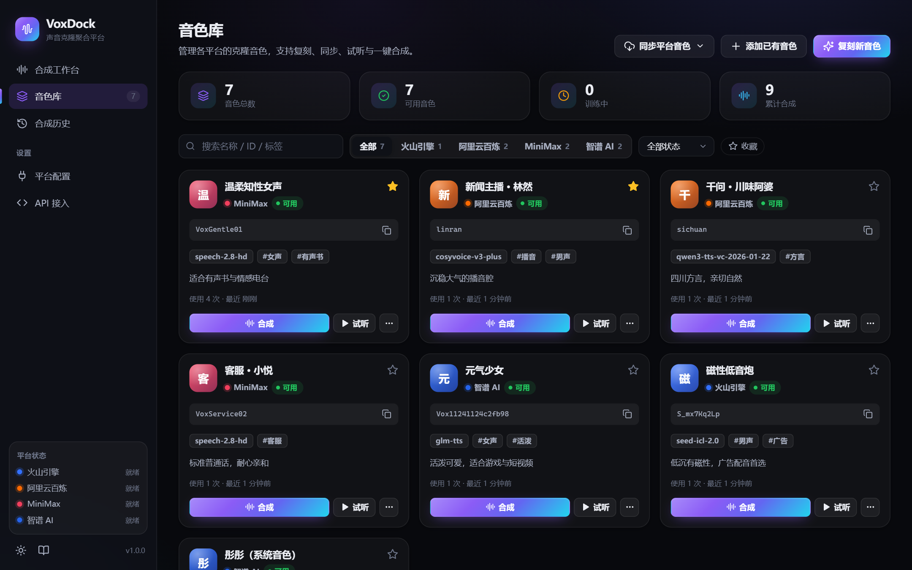
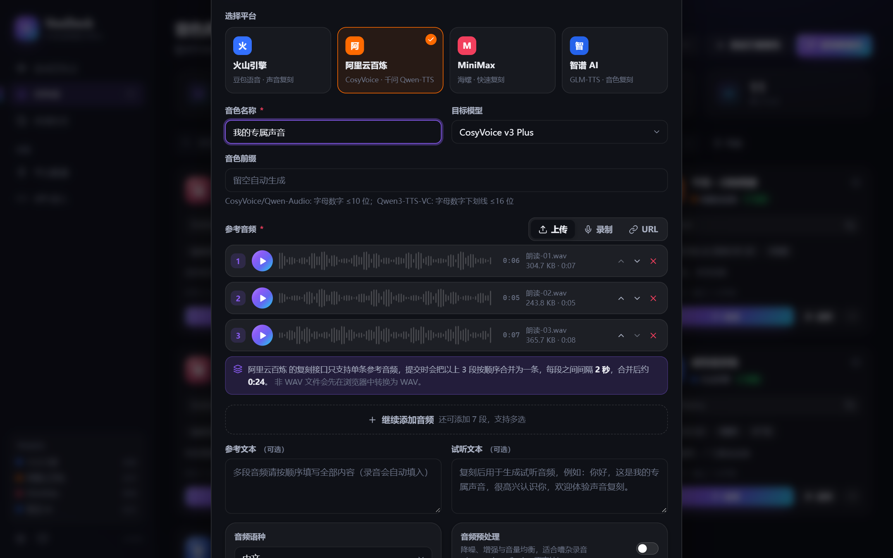
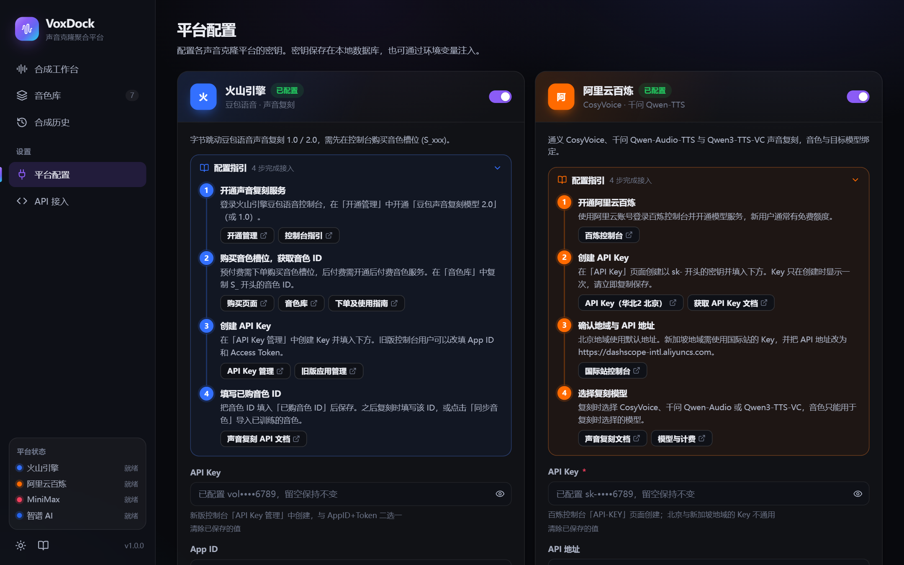
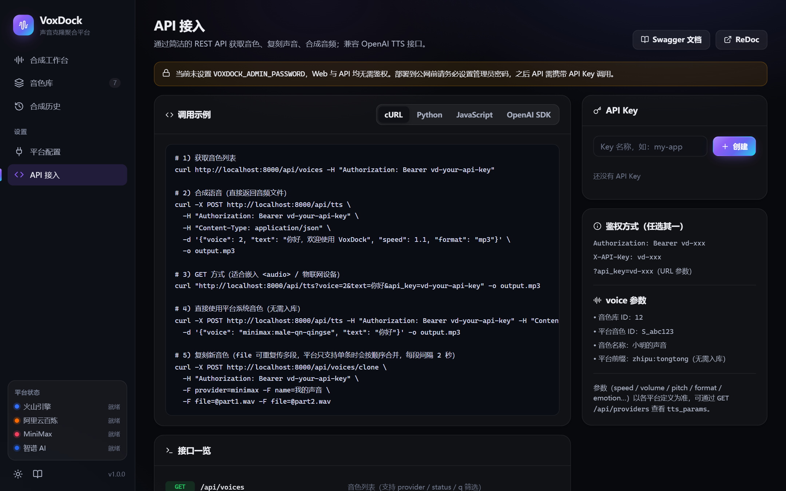
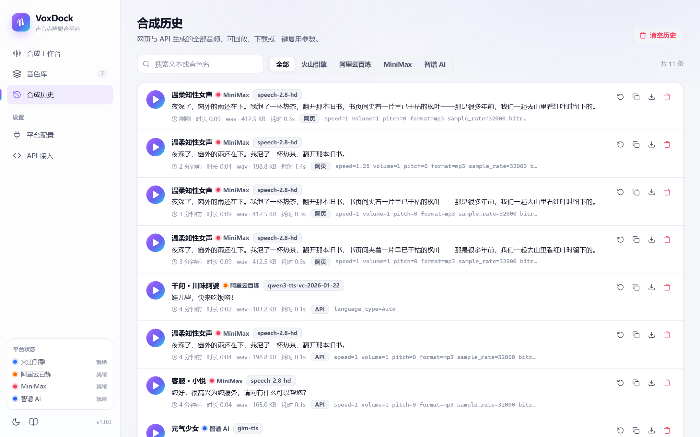
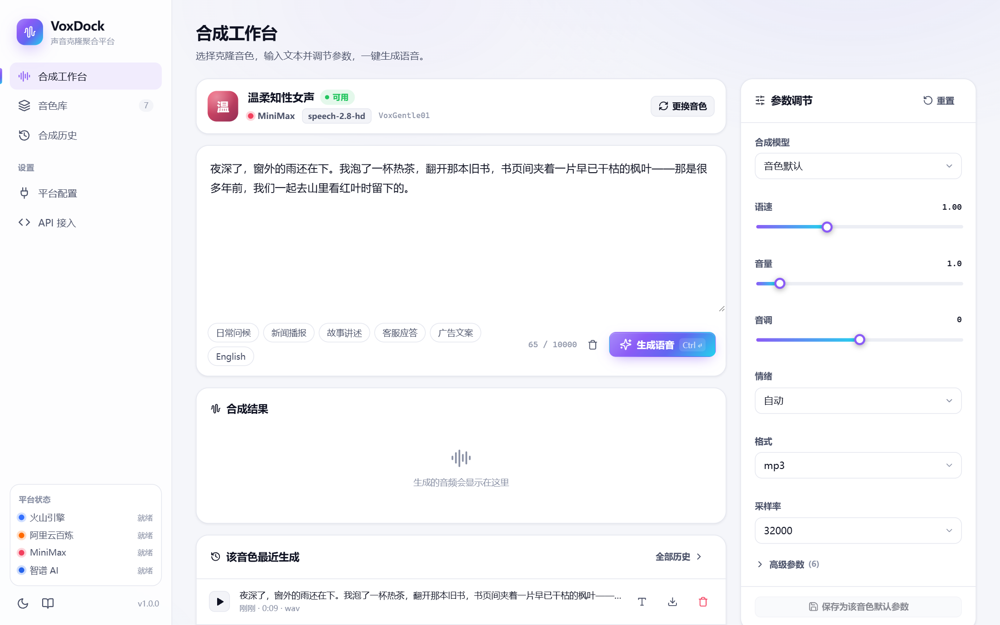

<div align="center">



<h3>一站式声音克隆工作台：管理音色、在线试听调参，并用一套 API 调用四大平台</h3>

<p>
  <a href="../../releases"></a>
  <a href="../../pkgs/container/voxdock"></a>
  <a href="../../actions"></a>
  
  
  <a href="LICENSE"></a>
</p>

<p>
  <a href="#-快速开始">快速开始</a> ·
  <a href="#-界面预览">界面预览</a> ·
  <a href="#-支持平台">支持平台</a> ·
  <a href="#-api">API</a> ·
  <a href="#-配置">配置</a> ·
  <a href="#-常见问题">FAQ</a>
</p>

</div>

---

**VoxDock** 是一个基于 Python（FastAPI）的自托管 Web 服务。它把 **火山引擎（豆包语音）**、**阿里云百炼（CosyVoice / 千问 Qwen-TTS）**、**MiniMax**、**智谱 AI（GLM-TTS）** 的声音复刻与语音合成能力整合到同一个界面和同一套 API 中：

- 🎙️ **复刻声音**：上传音频、在浏览器中录音或填写 URL，**支持多段参考音频**，几步就能生成专属音色
- 🗂️ **管理音色**：统一的音色库，支持收藏、标签、状态跟踪，并能从各平台同步已有音色
- 🎛️ **试听调参**：根据各平台的参数自动生成调节面板，实时生成并显示波形播放
- 🔌 **简单 API**：一个 `POST /api/tts` 就能用任意平台的音色合成，还兼容 OpenAI TTS 接口
- 🐳 **开箱即用**：Docker 单容器 + SQLite，一条命令完成部署（amd64 / arm64）；还提供 **Windows 免安装版**，双击即可运行

## ✨ 特性

<table>
<tr>
<td width="50%" valign="top">

**🎨 Web 工作台**
- 深色 / 浅色主题，适配桌面和移动端
- 合成工作台：在音色选择器、文本编辑器和参数面板中操作，`Ctrl+Enter` 一键生成
- 波形播放器 + 全局迷你播放条，支持拖动定位
- 浏览器内录音，自动编码为 24kHz WAV；可连续录多段，朗读文稿自动轮换
- 多段参考音频：可排序、删除；平台只支持单条时，按顺序合并并在每段之间插入 2 秒静音
- 合成历史：回放、下载，可一键把文本和参数复用到工作台

</td>
<td width="50%" valign="top">

**⚙️ 服务端**
- 统一抽象 4 个平台的复刻、查询、列表、删除和合成
- 训练状态在后台自动轮询（火山 / 阿里审核）
- 平台试听音频自动转存本地，不受链接过期影响
- 参考音频格式不受支持时，用 ffmpeg 自动转换；多段 WAV 合并使用纯 Python 实现，不依赖 ffmpeg
- 管理员登录 + API Key 鉴权，平台密钥只显示脱敏后的内容
- 平台配置页内置分步接入指引，可一键跳转到各平台的开通、充值、API Key 页面
- 自带 Swagger / ReDoc 交互式文档

</td>
</tr>
</table>

## 🖼 界面预览

<table>
<tr>
<td colspan="2"><p align="center"><b>合成工作台</b>：选择音色、调节参数、实时波形回放</p></td>
</tr>
<tr>
<td width="50%"><p align="center"><b>音色库</b>：跨平台统一管理</p></td>
<td width="50%"><p align="center"><b>复刻新音色</b>：上传 / 录制 / URL</p></td>
</tr>
<tr>
<td width="50%"><p align="center"><b>平台配置</b>：密钥管理与连接测试</p></td>
<td width="50%"><p align="center"><b>API 接入</b>：Key 管理与调用示例</p></td>
</tr>
<tr>
<td width="50%"><p align="center"><b>合成历史</b>（浅色主题）</p></td>
<td width="50%"><p align="center"><b>浅色主题</b></p></td>
</tr>
</table>

## 🧩 支持平台

| 平台 | 复刻模型 / 合成接口 | 复刻 | 状态查询 | 音色列表同步 | 删除平台音色 | 可调参数 |
| --- | --- | :---: | :---: | :---: | :---: | --- |
|  | 声音复刻 1.0 / 2.0（`seed-icl-*`），V3 接口 | ✅ | ✅ | ✅¹ | — | 语速、音量、音调、格式、采样率、2.0 合成模型、语种 |
|  | CosyVoice v3 / v3.5、千问 Qwen-Audio-TTS 3.x、千问 Qwen3-TTS-VC | ✅ | ✅ | ✅ | ✅ | 语速、音量、音调、格式、采样率、指令控制、语种、种子 |
|  | 快速复刻 + Speech 2.8 / 2.6 / 02 / 01 | ✅ | ✅ | ✅ | ✅ | 模型、语速、音量、音调、情绪、格式、采样率、比特率、语种增强、音色微调、音效 |
|  | GLM-TTS-Clone + GLM-TTS | ✅ | ✅ | ✅ | ✅ | 语速、音量、水印 |

> ¹ 火山引擎没有音色列表接口。请在配置中填写已购买的音色 ID（`S_xxx`），同步时会逐个查询状态。
>
> 阿里云的复刻音色与 **目标模型绑定**，VoxDock 会记住每个音色的模型，并自动选择对应的复刻接口（`voice-enrollment` / `qwen-voice-enrollment`）和合成接口（`SpeechSynthesizer` / `multimodal-generation`）。

## 🚀 快速开始

### Windows 免安装版（一键运行）

1. 从 [Releases](../../releases/latest) 下载 `VoxDock-x.y.z-windows-x64.zip` 并解压
2. 双击 **`VoxDock.exe`**，浏览器会自动打开 <http://127.0.0.1:8000>
3. 在「平台配置」中填写密钥即可开始使用；关闭命令行窗口即可退出

> 无需安装 Python。数据保存在程序目录下的 `data\` 文件夹，迁移或升级时复制这个文件夹即可。可选配置：把 `.env.example` 复制为 `.env` 后修改端口、局域网访问（`VOXDOCK_HOST=0.0.0.0`）、管理员密码等。首次运行如果出现 SmartScreen 提示，请点击「更多信息 → 仍要运行」（程序未做代码签名）。

### Docker（服务器部署推荐）

```bash
docker run -d --name voxdock \
  -p 8000:8000 \
  -e VOXDOCK_ADMIN_PASSWORD=change-me \
  -v $(pwd)/data:/data \
  ghcr.io/aiqinxuancai/voxdock:latest
```

打开 <http://localhost:8000>，输入管理员密码登录，然后在 **平台配置** 中填写各平台密钥即可使用。

### Docker Compose

```bash
git clone https://github.com/aiqinxuancai/VoxDock.git && cd VoxDock
cp .env.example .env        # 设置 VOXDOCK_ADMIN_PASSWORD，平台密钥可选
docker compose up -d        # 默认拉取 GHCR 镜像；加 --build 可本地构建
```

### 本地运行

```bash
python -m venv .venv && source .venv/bin/activate   # Windows: .venv\Scripts\activate
pip install -r requirements.txt
cp .env.example .env
python -m app                         # 启动并自动打开浏览器（默认 127.0.0.1:8000）
# 或开发模式：uvicorn app.main:app --reload --port 8000
```

> 💡 浏览器录音需要在 **HTTPS** 或 `localhost` 下使用。部署到公网时，请放在反向代理（Nginx / Caddy）后面并开启 HTTPS。

## 🔌 API

完整的交互式文档：`/docs`（Swagger）、`/redoc`。
鉴权方式三选一：`Authorization: Bearer <key>` · `X-API-Key: <key>` · `?api_key=<key>`

### 合成语音

```bash
# 直接返回音频文件
curl -X POST http://localhost:8000/api/tts \
  -H "Authorization: Bearer vd-xxxx" \
  -H "Content-Type: application/json" \
  -d '{"voice": 1, "text": "你好，欢迎使用 VoxDock", "speed": 1.1, "format": "mp3"}' \
  -o output.mp3

# GET 方式，适合 <audio src> / 物联网设备
curl "http://localhost:8000/api/tts?voice=1&text=你好&api_key=vd-xxxx" -o output.mp3
```

`voice` 支持以下几种写法：

| 写法 | 示例 | 说明 |
| --- | --- | --- |
| 音色库 ID | `12` | 本地音色库中的 ID |
| 平台音色 ID | `S_abc123` / `cosyvoice-v3-plus-myvoice-xxx` | 自动匹配音色库 |
| 音色名称 | `小明的声音` | 精确匹配 |
| `provider:voice_id` | `minimax:male-qn-qingse` / `zhipu:tongtong` | **无需入库**，可直接使用平台系统音色 |

常用参数可以直接放在顶层（`speed` / `volume` / `pitch` / `format` / `sample_rate` / `emotion` / `instruction` / `language`），也可以放进 `params`。各平台支持的完整参数和取值范围见 `GET /api/providers` 返回的 `tts_params`。
`output` 取 `audio`（默认，直接返回音频）时，可通过 `X-Generation-Id`、`X-Audio-Duration-Ms` 等响应头获取元数据；取 `url` / `base64` 时返回 JSON。

### 获取音色 / 复刻音色

```bash
# 音色列表（支持 provider / status / q 筛选）
curl http://localhost:8000/api/voices -H "Authorization: Bearer vd-xxxx"

# 上传参考音频复刻（file 字段可以重复传多段）
curl -X POST http://localhost:8000/api/voices/clone \
  -H "Authorization: Bearer vd-xxxx" \
  -F provider=aliyun -F name=我的声音 -F model=cosyvoice-v3-plus \
  -F file=@part1.wav -F file=@part2.mp3
```

### OpenAI 兼容

```python
from openai import OpenAI

client = OpenAI(base_url="http://localhost:8000/v1", api_key="vd-xxxx")
with client.audio.speech.with_streaming_response.create(
    model="tts-1", voice="小明的声音", input="你好，这是 OpenAI 兼容接口"
) as resp:
    resp.stream_to_file("output.mp3")
```

<details>
<summary><b>接口一览</b></summary>

| 方法 | 路径 | 说明 |
| --- | --- | --- |
| `GET` | `/api/voices` | 音色列表 |
| `POST` | `/api/voices/clone` | 复刻新音色（multipart，`file` 可传多个） |
| `POST` | `/api/voices` | 添加已有平台音色 |
| `GET` / `PATCH` / `DELETE` | `/api/voices/{id}` | 详情 / 编辑 / 删除（`?remote=true` 同时删除平台音色） |
| `POST` | `/api/voices/{id}/refresh` | 刷新训练状态 |
| `GET` | `/api/voices/{id}/sample` · `/demo` | 参考音频 / 平台试听音频 |
| `POST` / `GET` | `/api/tts` | 合成语音 |
| `GET` | `/api/generations` | 合成历史 |
| `GET` / `DELETE` | `/api/generations/{id}` (`/audio`) | 下载 / 删除历史 |
| `GET` | `/api/providers` | 平台、模型与参数定义 |
| `POST` | `/api/providers/{name}/sync` | 同步平台音色 |
| `POST` | `/v1/audio/speech` | OpenAI 兼容 TTS |

</details>

## ⚙ 配置

所有配置都可以通过环境变量（或 `.env`）设置。平台密钥也可以在 Web 界面中填写，**数据库中的配置优先于环境变量**。

| 变量 | 默认值 | 说明 |
| --- | --- | --- |
| `VOXDOCK_ADMIN_PASSWORD` | 空 | 管理员密码。为空时 Web 和 API 都不鉴权，**请勿直接暴露到公网** |
| `VOXDOCK_API_KEYS` | 空 | 额外的静态 API Key，逗号分隔 |
| `VOXDOCK_SECRET_KEY` | 自动生成 | 会话签名密钥 |
| `VOXDOCK_DATA_DIR` | `data`（容器内 `/data`） | SQLite 数据库与音频文件目录 |
| `VOXDOCK_REQUEST_TIMEOUT` | `120` | 调用平台的超时时间（秒） |
| `VOXDOCK_MAX_UPLOAD_MB` | `20` | 单个参考音频文件的大小上限 |
| `VOXDOCK_MAX_REFERENCE_AUDIOS` | `10` | 单次复刻最多上传几段参考音频 |
| `VOXDOCK_MERGE_GAP_SECONDS` | `2` | 多段参考音频本地合并时的静音间隔（秒） |
| `VOLC_API_KEY` / `VOLC_APP_ID` / `VOLC_ACCESS_TOKEN` | | 火山引擎：新版 API Key，或旧版 AppID + Token |
| `VOLC_SPEAKER_IDS` | | 火山已购音色 ID，用于同步 |
| `DASHSCOPE_API_KEY` / `DASHSCOPE_BASE_URL` | | 阿里云百炼；新加坡地域请使用 `https://dashscope-intl.aliyuncs.com` |
| `MINIMAX_API_KEY` / `MINIMAX_BASE_URL` | | MiniMax；国际站请使用 `https://api.minimax.io` |
| `ZHIPU_API_KEY` | | 智谱 AI |

## 🗂 项目结构

```
VoxDock/
├── app/
│   ├── main.py              # FastAPI 入口、异常处理、静态资源
│   ├── launcher.py          # 桌面启动器（python -m app / VoxDock.exe）
│   ├── config.py            # 配置（环境变量 / .env）
│   ├── models.py · db.py    # SQLAlchemy 模型（SQLite + aiosqlite）
│   ├── auth.py              # 管理员会话 + API Key
│   ├── audio.py             # 格式识别、WAV 封装、ffmpeg 转换、时长估算
│   ├── providers/           # 平台适配层（统一的 BaseProvider 抽象）
│   │   ├── volcengine.py  aliyun.py  minimax.py  zhipu.py
│   ├── services/            # 业务编排：复刻 / 同步 / 合成 / 存储
│   ├── routers/             # REST API
│   └── static/              # Web 前端（Vue 3 ESM，免构建）
├── tests/                   # pytest + respx 模拟各平台接口
├── packaging/windows/       # PyInstaller 配置、打包脚本、图标、使用说明
├── Dockerfile · docker-compose.yml
└── .github/workflows/       # CI、GHCR 镜像发布、Release
```

**新增平台** 只需要继承 `BaseProvider`，声明 `credential_fields` / `models` / `clone_fields` / `tts_params`，并实现 `clone` / `synthesize` 等方法，再注册到 `providers/__init__.py`。前端表单会根据这些声明自动生成。

## 🛠 开发

```bash
pip install -r requirements-dev.txt
pytest            # 测试（各平台接口均已 mock，无需真实密钥）
ruff check app tests
```

### 发布

发布只由版本标签触发，推送普通提交不会构建镜像或发布。推送 `v` 开头的语义化版本标签后，GitHub Actions 会自动完成以下步骤：测试 → 构建多架构 Docker 镜像并推送到 GHCR → 构建 Windows 免安装版（构建后会实际启动 exe 做冒烟测试）→ 创建 Release。

```bash
git tag v1.0.0 && git push origin v1.0.0
```

| 触发方式 | Docker 镜像标签 | Windows 免安装版 | Release |
| --- | --- | --- | --- |
| 推送正式版标签 `v1.2.3` | `1.2.3` · `1.2` · `1` · `latest` · `sha-xxxx` | ✅ 作为 Release 附件 | ✅ 自动生成更新日志，并附带 Windows 版、Docker 部署包和源码包 |
| 推送预发布标签 `v1.2.3-beta.1` | `1.2.3-beta.1` · `sha-xxxx`（不更新 `latest`） | ✅ 作为 Release 附件 | ✅ 标记为 Pre-release |
| Pull Request | —（只运行测试） | — | — |

> `0.x` 版本不会生成单独的主版本号镜像标签（如 `0`）。

本地构建 Windows 免安装版（需要 Python 3.10+）：

```bat
packaging\windows\build.bat 1.0.0
:: 输出 dist\VoxDock\VoxDock.exe 和 dist\VoxDock-1.0.0-windows-x64.zip
```

## ❓ 常见问题

<details>
<summary><b>火山引擎复刻时提示音色 ID 无效或 resource ID mismatch？</b></summary>

火山声音复刻需要先在控制台购买音色槽位，拿到 `S_` 开头的音色 ID 后再填入复刻表单。合成时使用的模型（`seed-icl-1.0` / `seed-icl-2.0`）必须与购买的商品版本一致，可以在音色的「编辑」中修改。
</details>

<details>
<summary><b>MiniMax 复刻的音色不见了？</b></summary>

MiniMax 规定：复刻的音色如果 7 天内没有用于正式合成，会被平台自动删除。另外，复刻音色要在首次合成后才会出现在平台的音色列表中。
</details>

<details>
<summary><b>阿里云复刻后状态一直是「训练中」？</b></summary>

CosyVoice / Qwen-Audio 的音色需要经过审核（`DEPLOYING` → `OK`），VoxDock 会在后台自动轮询，也可以在音色卡片菜单中点击「刷新状态」。千问 Qwen3-TTS-VC 的音色创建后即可使用。
</details>

<details>
<summary><b>多段参考音频是怎么处理的？</b></summary>

目前这 4 个平台的复刻接口都只接收一条参考音频。上传或录制多段时，VoxDock 会按列表顺序把它们合并成一条 24kHz 单声道 WAV，每段之间插入 2 秒静音（可用 `VOXDOCK_MERGE_GAP_SECONDS` 调整），再提交给平台。合并结果会保存为音色的参考音频，可以在音色库中回放。

- 都是 WAV 时直接用 Python 合并；包含 mp3 / m4a 等格式时，服务端用 ffmpeg 解码。服务端没有 ffmpeg 时，网页会先在浏览器里把这些文件转成 WAV。
- 「参考文本」要按顺序写出全部片段的内容（录音时会自动填入）。合并后的总时长也要符合各平台的限制，例如智谱建议 3~30 秒。

</details>

<details>
<summary><b>上传的 m4a / webm 等格式被拒绝？</b></summary>

Docker 镜像内置了 ffmpeg，不受支持的格式会自动转换为 WAV。使用 Windows 免安装版时，把 `ffmpeg.exe` 放到 `VoxDock.exe` 同一目录即可；其他本地运行方式请自行安装 ffmpeg，或改为上传 wav / mp3。
</details>

<details>
<summary><b>浏览器无法录音？</b></summary>

浏览器只允许在安全上下文（HTTPS 或 `localhost`）中访问麦克风。请为服务配置 HTTPS。
</details>

## 📄 License

[MIT](LICENSE) © VoxDock contributors

<sub>本项目与各云服务厂商无隶属关系，使用各平台服务时请遵守其服务条款。声音复刻请确保已获得声音所有者授权。</sub>
